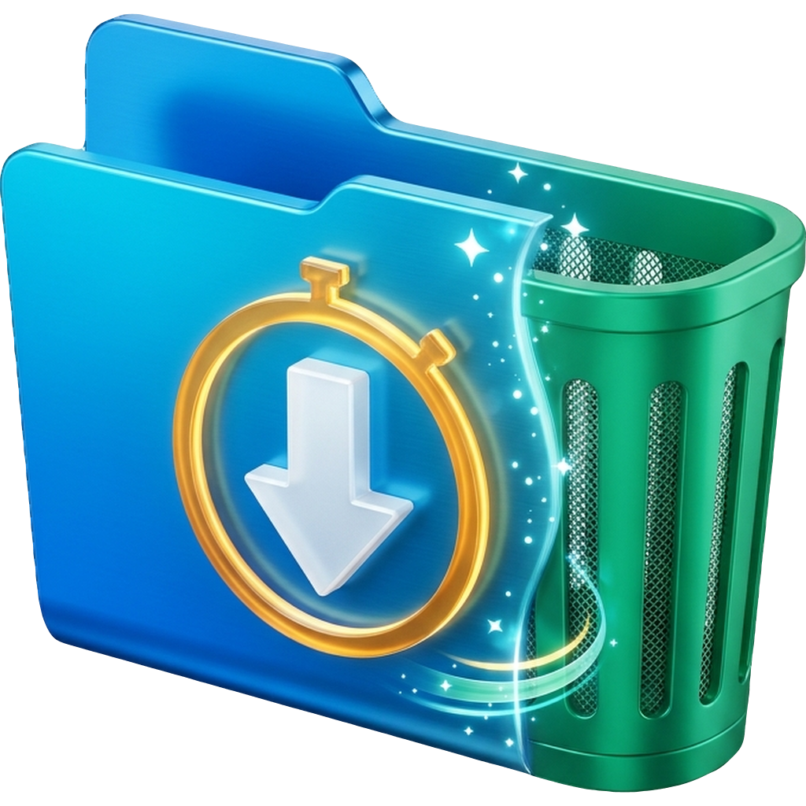
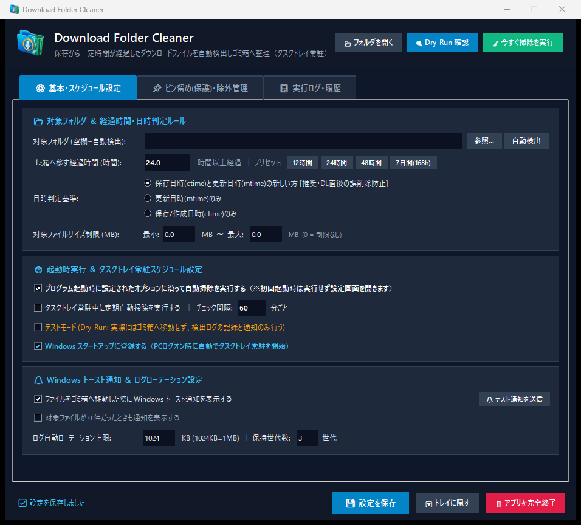

<div align="center">



# Download Folder Cleaner

**ダウンロードフォルダ内で保存から一定時間が経過したファイルを自動検出し、安全にゴミ箱へ整理するタスクトレイ常駐ツール**

[](https://github.com/777Labs/DownloadFolderCleaner/releases)
[](https://github.com/777Labs/DownloadFolderCleaner)
[](LICENSE)

[📥 最新版をダウンロード (Releases)](https://github.com/777Labs/DownloadFolderCleaner/releases/latest)

</div>

---

## 📸 スクリーンショット



---

## ✨ 主な特徴

- 🚀 **完全スタンドアロン・ポータブル設計**:
  - インストール不要のポータブル設計。単一の実行ファイル（`DownloadFolderCleaner.exe`）だけでどの Windows 11 PC でも即座に起動します。
- 🕒 **インテリジェントな日時判定 ＆ 安全なゴミ箱移動**:
  - 完全削除ではなく Windows の**ゴミ箱（Recycle Bin）**へ移動するため、万が一の際もゴミ箱から簡単に復元できます。
  - **「保存日時(`ctime`)と更新日時(`mtime`)の新しい方」**を判定基準とする推奨モードにより、配布元での更新日時が古いインストーラやアーカイブがダウンロード直後に誤って削除されるのを防ぎます。
  - フォルダは配下の全ファイルを含めた最新日時を高速スキャンし、内部に新しいファイルが含まれるフォルダは自動的に保護します。
- 📌 **ワンクリック・ピン留め（保護）＆ 柔軟な除外ルール**:
  - 設定画面のファイル一覧から、消したくないファイル・フォルダをダブルクリックまたはワンクリックで**個別ピン留め保護**できます。
  - 先頭プレフィックス（`_`, `📌`, `!` 等）による保護、ワイルドカード除外（ダウンロード中の `*.crdownload`, `*.part`, `*.tmp` 等）、拡張子別の保持時間（例: `.iso=12, .pdf=168`）、最小/最大サイズ制限（MB単位）に対応。
- 🖥️ **スマートなタスクトレイ常駐 ＆ 起動制御**:
  - **初回起動時**は自動掃除を実行せずに設定画面を開き、**2回目以降の起動時**はタスクトレイに常駐して設定に沿った自動掃除を実行します。
  - **二重起動防止**に対応し、すでに常駐している状態でアプリを再起動すると、既存プロセスの設定画面を記憶していた表示位置に最前面表示します。
  - Windows スタートアップ登録機能を内蔵（デフォルトON）しており、タスクスケジューラの手動設定なしでログオン時の自動実行が可能です。
- 🔔 **Windows トースト通知 ＆ ログ自動ローテーション**:
  - ゴミ箱へ移動した件数と解放された合計サイズを Windows トースト通知でお知らせします。
  - ログファイルが上限サイズ（デフォルト 1MB）を超えると自動で世代ローテーションを行い、アプリ内のログビューアからいつでも履歴を確認できます。

---

## 📥 ダウンロードと使い方

### 1. ダウンロード
右側の [**Releases**](https://github.com/777Labs/DownloadFolderCleaner/releases) ページから最新の `DownloadFolderCleaner-v1.0.0-win-x64.zip` をダウンロードしてください。

### 2. 起動方法
1. ダウンロードした ZIP ファイルをお好みのフォルダーに展開（解凍）します。
2. 展開されたフォルダー内の `DownloadFolderCleaner.exe` をダブルクリックして起動します。
3. **初回起動時**は設定画面が表示されます。経過時間（デフォルト24時間）や保護設定を確認し、「**💾 設定を保存**」をクリックしてください。
4. ウィンドウ右上の `×` ボタンまたは「**🔽 トレイに隠す**」を押すとタスクトレイへ格納されます。次回起動時からは設定に沿って自動で掃除が実行されます。

---

> [!IMPORTANT]
> ### 🛡️ Windows SmartScreen 警告が出た場合
> インターネットから新しくダウンロードしたアプリを初めて起動する際、Windows によって「**Windows によって PC が保護されました**」という青い画面が表示される場合があります。
> 
> これは個人開発のフリーソフトにおいてデジタル署名が未知であるために表示される標準的なセキュリティ確認画面です。以下の手順でそのまま起動できます：
> 1. 画面内の「**詳細情報**」リンクをクリックします。
> 2. 右下に表示される「**実行**」ボタンをクリックします。
> （一度実行を許可すれば、次回以降はこの画面は表示されなくなります）

---

## ⌨️ 主な操作・コマンドラインオプション

| 操作 / オプション | 機能・動作 |
| :--- | :--- |
| トレイアイコン左クリック / 再起動 | 設定画面を記憶位置（940×825）に復元して最前面に表示 |
| トレイアイコン右クリック | コンテキストメニュー（今すぐ掃除 / Dry-Run確認 / 定期自動掃除ON・OFF / フォルダ・ログを開く / 終了） |
| `🔍 Dry-Run 確認` | 実際にはゴミ箱へ移動せず、現在の設定で対象となる候補ファイルと合計サイズを検出・記録 |
| `🧹 今すぐ掃除を実行` | 現在の設定に従って対象ファイルを即座にゴミ箱へ移動 |
| ファイル一覧のダブルクリック | 「📌 ピン留め(保護)・除外管理」タブ内で選択項目の個別ピン留め保護を ON / OFF 切替 |
| `DownloadFolderCleaner.exe --settings` | 起動時に設定画面を強制的に表示 |
| `DownloadFolderCleaner.exe --cli` | タスクトレイ常駐を行わず、コマンドライン（Dry-Run / `--execute --yes`）として1回実行して終了 |

---

## 💻 動作環境

- **OS**: Windows 10 (64-bit) / Windows 11 (64-bit)
- **ランタイム**: 不要（必要な実行エンジンが exe に内包されているため、追加のランタイムインストールは不要です）

---

## 🛠️ ビルド手順 (開発者向け)

本プロジェクトをソースコードからビルドする場合は、Python 3.11 以降および PyInstaller が必要です。

```powershell
# 仮想環境の有効化と依存パッケージのインストール
.\.venv\Scripts\activate
pip install -r requirements.txt
pip install pyinstaller

# 単一実行ファイル (DownloadFolderCleaner.exe) のビルド
pyinstaller --noconfirm --clean --onefile --windowed `
  --name "DownloadFolderCleaner" `
  --icon "assets/icon.ico" `
  --add-data "assets;assets" `
  main.py
```

---

## 📄 利用規約・ライセンス

本ソフトウェアは **無料（フリーウェア）** として提供されています。個人利用・商用利用を問わず、どなたでも無償でご利用いただけます。
詳細については [LICENSE](LICENSE) をご確認ください。

---

## 👤 作者 / お問い合わせ

- **開発者 / 団体名**: 777 Labs
- **Webサイト / GitHub**: [https://github.com/777Labs](https://github.com/777Labs)
- **不具合報告・ご要望**: [GitHub Issues](https://github.com/777Labs/DownloadFolderCleaner/issues)
